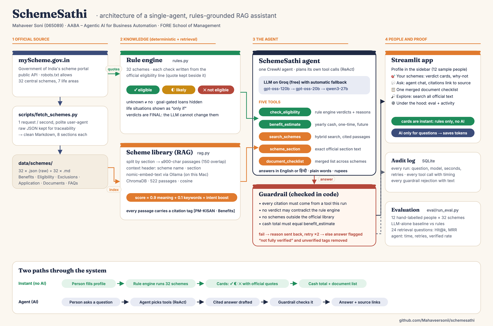

# SchemeSathi · योजना साथी

**An AI agent that tells an Indian citizen which central government schemes they can get, how much they are worth, and exactly how to apply, with the official source for every line.**

Individual assignment · *AABA – Agentic AI for Business Automation* · PGDM-BDA, Term 04, 2026-27 · FORE School of Management
Mahaveer Soni (065089)



## The problem

India runs hundreds of welfare schemes, but many eligible people never claim them. They don't know a scheme exists, can't read the eligibility rules, don't know which documents to bring, or are misled by middlemen. A general chatbot makes this worse: it answers confidently, invents rules and amounts, and can't show where an answer came from.

SchemeSathi is built so that it **cannot guess**:

* **Eligibility comes from a rule engine, not the LLM.** Every check is written from the official eligibility line on myScheme, and the quote is kept next to it. The verdict is *eligible*, *likely* (one thing still needs confirming) or *not eligible* (with the failed rule quoted).
* **Facts come from retrieval (RAG)** over the official text of 32 schemes. Every passage carries a citation tag such as `[PM-KISAN · Benefits]`.
* **One agent** decides which of its five tools to call and writes a plain-language answer in English or Hindi.
* **A guardrail in code** rejects an answer if:
  - it cites a passage no tool returned;
  - it contradicts a rule-engine verdict;
  - it talks about schemes outside the library;
  - it states a cash total different from the computed one.

  The model is told why and retries. If it still fails, the answer is flagged "not fully verified".

## What's inside

| Layer | File | What it does |
|---|---|---|
| Data | `scripts/fetch_schemes.py` | Downloads 32 schemes from the myScheme public API (1 request/s) and keeps the raw JSON plus clean Markdown |
| Rules | `schemesathi/rules.py` | 32 schemes, each check with its official quote; handles unknowns, goal-gated loans and life situations |
| Library | `schemesathi/rag.py` | Section-aware chunks ≤900 characters, nomic-embed-text (Ollama, local), ChromaDB, hybrid score with a question-intent boost, merged document lists |
| Agent | `schemesathi/agent.py`, `tools.py`, `llm.py` | One CrewAI agent, five tools, guardrail, model fallback on Groq (gpt-oss-120b → gpt-oss-20b → qwen3) |
| Audit | `schemesathi/log.py` | SQLite log of every run, tool call and guardrail rejection |
| App | `app/streamlit_app.py`, `app/ui.py` | Profile sidebar with 12 sample people, verdict cards, why-not view, agent chat, document checklist, explorer, evaluation |
| Evaluation | `eval/run_eval.py` | Rules vs hand labels, LLM-alone baseline, retrieval Hit@k/MRR, agent end to end |
| Tests | `tests/test_core.py` | 36 offline tests (rules, chunking, documents, guardrail, tools) |

## Run it

```bash
git clone https://github.com/Mahaveersonii/schemesathi && cd schemesathi
python3.11 -m venv .venv && source .venv/bin/activate
pip install -r requirements.txt
cp .env.example .env              # paste a free Groq key from console.groq.com
ollama pull nomic-embed-text      # local embeddings (https://ollama.com)
python -c "from schemesathi import rag; print(rag.index())"   # build the library (~15 s)
streamlit run app/streamlit_app.py
```

The scheme text is already in `data/schemes/`. To refresh it from myScheme, run `python scripts/fetch_schemes.py`. Tests: `pytest -q`. Evaluation: `python eval/run_eval.py --baseline --agent 4`.

## Results

See `eval/results.json` and the **Under the hood** tab. Summary in the report (`docs/`).

## Limits

* It covers 32 central schemes, not state schemes.
* "Likely" verdicts still need the office to confirm things such as land records or SECC lists.
* Amounts are shown only where the official text states them.
* The personas were labelled by the author, so they are a check on the rules, not an independent audit.

Data source: [myScheme](https://www.myscheme.gov.in), Government of India. This is a student project, not an official service.
